<picture>
  <source media="(prefers-color-scheme: dark)" srcset="https://raw.githubusercontent.com/D-White-Bear-L/D-White-Bear-L/main/assets/banner-dark-badge.svg" />
  <source media="(prefers-color-scheme: light)" srcset="https://raw.githubusercontent.com/D-White-Bear-L/D-White-Bear-L/main/assets/banner-light.svg" />
  
</picture>

做人工智能，也做软件开发和大数据。

<picture>
  <source media="(prefers-color-scheme: dark)" srcset="https://raw.githubusercontent.com/D-White-Bear-L/D-White-Bear-L/output/github-contribution-grid-snake-dark.svg" />
  <source media="(prefers-color-scheme: light)" srcset="https://raw.githubusercontent.com/D-White-Bear-L/D-White-Bear-L/output/github-contribution-grid-snake.svg" />
  
</picture>
